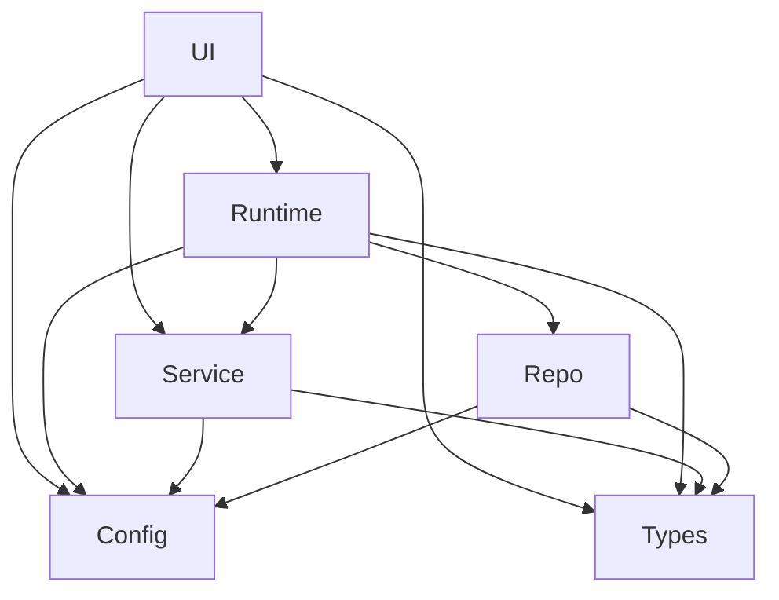

# 架构总览

## 一句话

Illumination 是一个通用 Agent Harness 骨架：给定一个目标，完成规划、编排、产物落盘与
可审计的结果返回；业务领域、执行器与真实工具按同一套契约逐步接入。

## 系统边界

- 输入：一个 `RunRequest`（目标、上下文、步骤上限）。
- 当前输出：`RunResult`（状态、计划、步骤结果、artifact 指针）与 `plan.json`。
- 不做：不内置具体业务领域；骨架阶段不执行真实副作用。
- 核心判据：**能用代码判定的写成代码；只有真正需要判断的才交给模型。**

## 六层代码架构

```text
Types → Config → Repo → Service → Runtime → UI
```

采用 B-strict：`Service` 只依赖 Types（含 ports）、Config 与自身；不直接 import Repo。
外部能力通过 `illumination.types.ports` 注入。



| 层 | 位置 | 职责 | 不要放什么 |
|---|---|---|---|
| Types | `src/illumination/types/` | Pydantic 契约、Enum、Protocol / ports | 业务逻辑、I/O |
| Config | `src/illumination/config/` | Settings、密钥、路径、启动校验 | 存储访问、业务规则 |
| Repo | `src/illumination/repo/` | LLM、时钟、artifact store 等适配器 | 领域规则、编排 |
| Service | `src/illumination/service/` | 规划、结构化输出校验等领域用例 | 建图、直接连外部服务 |
| Runtime | `src/illumination/runtime/` | LangGraph 编排、组合根、未来预算/HITL | 领域规则 |
| UI | `src/illumination/ui/` | CLI、参数校验、错误码映射 | import Repo、入口写业务逻辑 |

完整禁令见 [boundaries.md](boundaries.md)。

## 端口与组合根

端口定义在 `src/illumination/types/ports.py`：

```python
class LLMPort(Protocol): ...
class ClockPort(Protocol): ...
class ArtifactStorePort(Protocol): ...
```

- `repo` 实现端口。
- `service` 只依赖端口。
- `runtime/composition.py` 是组合根：实例化具体适配器并注入。
- 端口只使用领域类型和基本类型。

## 运行时骨架

当前图只有两个节点：

```text
START → plan → finalize → END
```

| 节点 | 职责 | 当前行为 |
|---|---|---|
| `plan` | 调规划服务，得到并校验 `RunPlan` | 成功 → `partial`；领域错误 → `failed` |
| `finalize` | 写 `plan.json` artifact，记录结束时间与终态 | 存储失败 → `failed` |

`partial` 是骨架的诚实状态：计划已产出，执行器尚未接入，步骤全部标记 `skipped`。
后续执行节点应插在 `plan` 与 `finalize` 之间，并按“下一步是否取决于上一步观察”选择
单次结构化调用或有界 ReAct 子代理。

## 数据与状态

- 图状态只放契约对象、摘要与 `ArtifactRef` 指针。
- 大批量正文、完整 prompt、原始外部响应永不进入状态或 checkpoint。
- 所有跨节点数据必须是 Pydantic 模型，禁止裸 dict 传递关键字段。
- 时间统一由 `ClockPort` 提供，测试用 `FakeClock`。

完整链路见 [data-flow.md](data-flow.md)。

## 质量门

当前阻断项：

- `arch_checker` 无违规；
- ruff lint / format 通过；
- mypy 无错误；
- pytest 全绿。

骨架阶段尚未实现、但接入时必须补齐的质量门：

- 引用/证据可核验率 = 100%；
- 预算与降级必须写入产物；
- 审计哈希链可回放；
- 沙箱隔离 conformance 全通过。

## 相关文档

- [boundaries.md](boundaries.md)：分层与导入边界的唯一事实源。
- [data-flow.md](data-flow.md)：状态、artifact 与失败分类。
- [../agents.md](../agents.md)：项目地图、契约与工作流。
- [../token-budget.md](../token-budget.md)：预算字段与降级。
